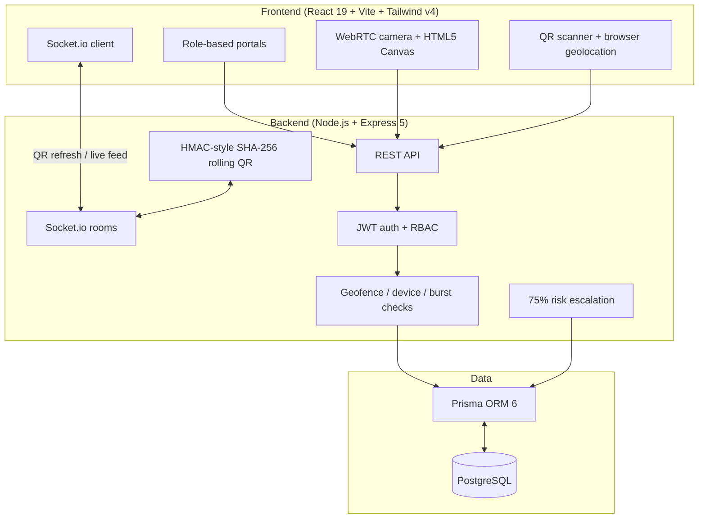

# EduPulse — Digital Educational Data Management Platform
> **Attendance automation • Rolling cryptographic QR • Geofence & device anti-proxy guard • Risk intervention**

EduPulse is a full-stack attendance platform for campuses. Students check in with a short-lived rolling QR code; the server verifies the signature, the classroom geofence, the device fingerprint and rapid reuse before recording attendance. Faculty get a live feed, manual overrides and a risk roster. Admins get institution analytics, a proxy quarantine queue and an audit trail.

---

## Architecture



**Stack:** React 19, Vite 8, Tailwind CSS 4, Recharts, Framer Motion, `html5-qrcode`; Node.js 20+, Express 5, Socket.io 4, Prisma 6, PostgreSQL; JWT, bcrypt, HMAC-SHA256 QR signing, Helmet, rate limiting.

---

## Feature overview

### Multi-role portals
- **Admin** — student/faculty/course counts, real overall attendance, 14-day activity trend, department comparison, risk segmentation, live proxy feed, proxy alert actions, audit logs, course management.
- **Faculty** — assigned courses, active lecture launcher, rolling QR projector, live check-in stream, manual overrides, students below 75%.
- **Student** — overall and per-course attendance, active lecture banner, QR check-in with GPS, camera capture verification, full attendance ledger.

### Rolling QR
- The server signs `sessionId:timestamp` with HMAC-SHA256 and broadcasts a fresh payload every `QR_REFRESH_INTERVAL` ms (7 s by default).
- Tokens are valid for `QR_VALIDITY_MS` (15 s by default), so screenshots and forwarded images expire quickly.
- QR rotation starts when a lecture is launched, resumes automatically after a server restart, and stops when the lecture ends.

### Anti-proxy checks
- **Geofence** — Haversine distance against the lecture coordinates and radius (10–1000 m) for `IN_PERSON` lectures. Missing or invalid GPS fails the check. `ONLINE` and `HYBRID` lectures intentionally disable the geofence to allow remote check-in; device and rapid-reuse checks still apply.
- **Shared device** — a browser-scoped fingerprint that checked in another student for the same lecture is quarantined.
- **Rapid duplicate** — same IP **and** device used by a different student within a 5 s window (IP alone is not used, which avoids campus NAT false positives).
- Quarantined attempts create a single `ProxyAlert` per student/lecture and an `FLAGGED_PROXY` attendance record.

### Risk intervention
- Every completed lecture writes one record per enrolled student, including `ABSENT`. Percentages therefore reflect lectures actually missed.
- Students below 75% are surfaced with a severity: `CRITICAL <50%`, `WARNING 50–65%`, `CAUTION 65–75%`. A healthy aggregate with one weak subject is surfaced as `CAUTION` until that subject recovers.
- Faculty can generate and download a formal parent/advisor warning notice.

### Attendance correctness
- `@@unique([sessionId, studentId])` makes duplicate check-ins impossible, even under concurrent requests.
- Ending a lecture writes `ABSENT` records for enrolled students who never checked in.
- Deleting a course cascades through sessions, records, alerts and enrollments.

> **Face verification is simulated.** This repository does not ship a biometric model. The camera capture still goes through the server's device/network checks, but the match itself is not a real identity verification. Use the QR flow for authenticated attendance.

---

## Demo credentials

| Role | Email | Password |
|---|---|---|
| Admin | `admin@edupulse.com` | `admin123` |
| Faculty | `faculty1@edupulse.com` | `faculty123` |
| Student | `student1@edupulse.com` | `student123` |

Additional faculty accounts: `faculty2@edupulse.com`, `faculty3@edupulse.com`.
Additional students: `student2@edupulse.com` … `student15@edupulse.com` (password `student123`).
Public registration cannot create admin accounts.

---

## Local setup

### Prerequisites
- Node.js 20+
- PostgreSQL 16+ (the example uses port `5433`; change `DATABASE_URL` if yours is on `5432`)

```bash
# 1. Install dependencies
npm install
cd server && npm install
cd ../client && npm install

# 2. Configure the server
cd ../server
cp .env.example .env
# edit DATABASE_URL and JWT_SECRET

# 3. Create the schema and seed the demo data
npm run db:push
npm run db:seed

# 4. Start both apps from the repository root
cd ..
npm run dev
```

Open **http://localhost:5173**. The API runs on **http://localhost:5001**.

> Camera and geolocation require a secure context. `localhost` counts as secure; a LAN IP over plain HTTP does not.

---

## Verification

With the server running and the database seeded:

```bash
npm run smoke
```

The smoke test exercises health, authentication, RBAC, dashboards, course/enrollment management, session lifecycle, QR check-in, duplicate rejection, geofence quarantine, shared-device quarantine, proxy approval, manual override, Socket.io authorization, absence recording and cascading course deletion. It creates and removes a temporary course, so the seeded demo data is preserved.

```bash
cd client
npm run lint     # 0 errors
npm run build    # production bundle
```

---

## Environment variables

### Server (`server/.env`)

| Variable | Default | Notes |
|---|---|---|
| `NODE_ENV` | `development` | `production` enables secure-secret checks and rate limiting |
| `PORT` | `5001` | API/WebSocket port |
| `DATABASE_URL` | — | PostgreSQL connection string (required) |
| `JWT_SECRET` | dev fallback | **Required in production**; must not equal the example value |
| `JWT_EXPIRES_IN` | `7d` | JWT lifetime |
| `QR_SECRET` | `JWT_SECRET` | Optional separate QR signing key |
| `QR_REFRESH_INTERVAL` | `7000` | Rolling QR period (ms, min 3000) |
| `QR_VALIDITY_MS` | `15000` | Token lifetime (ms, min 10000) |
| `CLIENT_URL` | `http://localhost:5173` | Comma-separated allowed browser origins |
| `PUBLIC_URL` | — | Public URL of this API (same-origin CORS) |
| `SERVE_CLIENT` | `true` in production | Serve `client/dist` from Express |
| `TRUST_PROXY` | `true` in production | Set behind a reverse proxy |
| `ADMIN_SIGNUP_ENABLED` | `false` | Never enable on a public deployment |
| `RATE_LIMIT_MAX` | `600` | API requests per window |
| `AUTH_RATE_LIMIT_MAX` | `30` | Auth attempts per window (production only) |

### Client (`client/.env`)

| Variable | Default | Notes |
|---|---|---|
| `VITE_API_URL` | `/api` | Use the full URL when the API is on another origin |
| `VITE_SOCKET_URL` | page origin | Use the API origin when hosted separately |

---

## Deployment

### Option A — single service (recommended)

Express serves the built SPA and the API on one origin.

```bash
# Build the SPA
cd client && npm ci && npm run build

# Install production server dependencies
cd ../server && npm ci

# Create/upgrade the schema. For a fresh database:
npx prisma db push
npm run db:seed        # optional demo data; omit for a real institution

# Start
NODE_ENV=production \
JWT_SECRET="$(openssl rand -base64 48)" \
DATABASE_URL="postgresql://..." \
PUBLIC_URL="https://edupulse.example.com" \
CLIENT_URL="https://edupulse.example.com" \
TRUST_PROXY=true \
SERVE_CLIENT=true \
npm start
```

`GET /api/health` returns `200` with `database: "up"` when the database is reachable, and `503` otherwise — use it as the platform health check.

### Option B — separate frontend and API

1. Deploy the server with `SERVE_CLIENT=false`, `CLIENT_URL=https://app.example.com`, and `PUBLIC_URL=https://api.example.com`.
2. Build the client with:
   ```bash
   VITE_API_URL=https://api.example.com/api \
   VITE_SOCKET_URL=https://api.example.com \
   npm run build
   ```
3. Serve `client/dist` from any static host and configure SPA rewrites to `index.html`.

### Production checklist
- [ ] Unique, long `JWT_SECRET` (the process refuses to start with the example value)
- [ ] `DATABASE_URL` points at a backed-up PostgreSQL instance
- [ ] HTTPS terminates in front of the app (required for camera/GPS)
- [ ] `CLIENT_URL` / `PUBLIC_URL` match the real domain(s)
- [ ] `TRUST_PROXY=true` behind Nginx/Render/Railway/Fly/Heroku
- [ ] `ADMIN_SIGNUP_ENABLED=false`
- [ ] `npm run db:push` (or a reviewed Prisma migration) applied
- [ ] `/api/health` monitored
- [ ] Demo seed **not** run on a real institution

---

## REST API

All routes are JSON and return `{ success, ... }`. Authentication uses `Authorization: Bearer <token>`.

### Auth — `/api/auth`
- `POST /register` — student/faculty self-registration (admins blocked)
- `POST /login`
- `GET /me`

### Admin — `/api/admin` (ADMIN)
- `GET /dashboard`
- `GET /proxy-alerts?resolved=true|false&search=...`
- `PATCH /proxy-alerts/:id` — `{ action: "APPROVE" | "BLOCK" | "FLAG" }`
- `GET /audit-logs`

### Faculty — `/api/faculty` (FACULTY, ADMIN)
- `GET /dashboard`
- `POST /sessions`
- `POST /sessions/:id/end`
- `GET /sessions/:id/live`
- `POST /override`
- `GET /student-risk?courseId=...`

### Student — `/api/student` (STUDENT)
- `GET /dashboard`
- `POST /scan-qr` — `{ qrToken, latitude?, longitude?, deviceInfo }`
- `POST /face-verify` — `{ sessionId, faceDataUrl, deviceInfo }` (simulated match)
- `GET /history?courseId=...`

### Courses — `/api/courses`
- `GET /` — authenticated
- `GET /:id` — authenticated
- `GET /students` — ADMIN/FACULTY
- `GET /faculty` — ADMIN
- `POST /` — ADMIN
- `PUT /:id` — ADMIN
- `DELETE /:id` — ADMIN (cascades)
- `POST /enroll` — ADMIN/FACULTY (faculty limited to own courses)

### Reports & interventions — `/api/attendance` (ADMIN, FACULTY)
- `GET /report?courseId=&studentId=&status=&startDate=&endDate=`
- `GET /interventions?courseId=&threshold=`
- `POST /generate-alert` — `{ studentId, courseId? }`

### Health
- `GET /api/health`

---

## Security model

- Passwords hashed with bcrypt (cost 12); login compares against a dummy hash for unknown emails.
- JWT is required for every protected route and for every Socket.io connection.
- Socket session rooms are limited to the owning faculty member and admins; students cannot subscribe to the rolling QR feed.
- Helmet security headers, CORS allow-list, request body limits and rate limiting are enabled.
- Role checks are enforced server-side; the client also hides routes by role.
- Inputs (UUIDs, enums, coordinates, dates, passwords, face payloads) are validated before database access.
- Prisma unique constraints guard duplicate attendance/alert rows.
- No stack traces or internal error details are exposed in production responses.

## Known limitations

- Facial matching is simulated; no biometric engine is bundled.
- Email delivery is not configured. Intervention notices are generated and downloaded as text files.
- Rolling QR rotation is per server process. A multi-instance deployment should move the rotation to a shared scheduler (e.g. Redis-backed worker) or enable sticky sessions.
- `prisma db push` is used for setup. For regulated deployments, generate and review Prisma migrations and use `prisma migrate deploy`.
